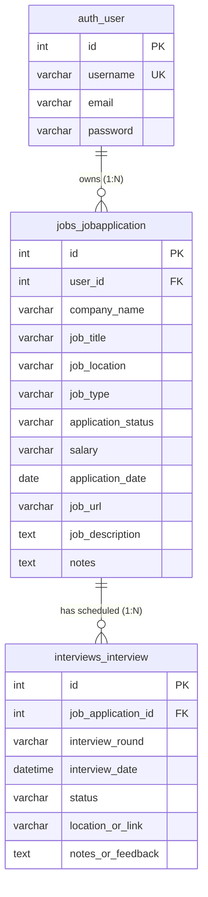

# JobTrack – Job Application Management System

[](https://www.python.org/)
[](https://www.djangoproject.com/)
[](https://www.django-rest-framework.org/)
[](https://www.mysql.com/)
[](https://getbootstrap.com/)
[](https://docs.djangoproject.com/en/4.2/topics/testing/)

> A production-quality, full-stack web application designed for freshers applying for **Python Full Stack Developer**, **Python Developer**, and **Django Developer** positions in India. Built with clean monolithic architecture, strictly normalized MySQL schema, responsive SaaS UI, RESTful APIs, and 100% automated test coverage.

---

## 📌 Table of Contents
1. [Project Overview](#-project-overview)
2. [Problem Statement](#-problem-statement)
3. [Key Features](#-key-features)
4. [Technology Stack](#-technology-stack)
5. [System Architecture](#-system-architecture)
6. [Database Design](#-database-design)
7. [REST API Documentation](#-rest-api-documentation)
8. [Installation & Local Setup](#-installation--local-setup)
9. [Automated Testing](#-automated-testing)
10. [Interview Preparation Package](#-interview-preparation-package)
11. [Troubleshooting Common Issues](#-troubleshooting-common-issues)
12. [Future Improvements](#-future-improvements)

---

## 🌟 Project Overview

**JobTrack** solves the disorganization and anxiety of modern job hunting. When job seekers apply across portals like LinkedIn, Naukri, Indeed, and company career portals, tracking application deadlines, recruiter follow-ups, multiple interview rounds, and preparation notes quickly becomes overwhelming.

JobTrack provides a centralized, secure web application where users can:
- Track applications through their complete lifecycle: `Applied` &rarr; `Shortlisted` &rarr; `Interview` &rarr; `Selected` / `Rejected`.
- Schedule multi-round interviews (`Technical`, `HR`, `Online`, `In-person`) with upcoming interview alerts and meeting links.
- View real-time database-driven analytics and conversion trends via **Chart.js**.
- Access data via both a responsive Bootstrap 5 web interface and a secure REST API.
- Maintain complete privacy with **strict user data isolation** (horizontal privilege protection).

---

## 🎯 Problem Statement
- **Spreadsheet Fatigue:** Maintaining Excel sheets is manual, prone to formatting errors, and lacks automated alerts.
- **Missed Opportunities:** Candidates lose track of interview dates, video meeting links, and interviewer feedback.
- **No Performance Visibility:** Job seekers cannot analyze which strategies or job types yield the highest interview conversion rates.

---

## ✨ Key Features

### 1. User Authentication & Profile
- User registration with email uniqueness validation and password confirmation.
- Secure login and session management powered by Django's authentication framework.
- PBKDF2 password hashing with SHA-256 (no plaintext storage).
- Edit personal profile details with total submission counters.

### 2. Live Interactive Dashboard
- 6 dynamic metric counters: **Total, Applied, Shortlisted, Interviews Scheduled, Selected, Rejected**.
- Search conversion rate indicators (Interview Rate and Offer Rate progress bars).
- Recent 5 applications quick table.
- Upcoming interviews alert card with meeting links.

### 3. Full Job Application CRUD
- **Create:** Company name, job title, location, type, status, salary, application date, URL, description, and notes.
- **Read:** Search by keyword, multi-criteria filter by status and job type, sorting, and pagination (10/page).
- **Update:** Edit any application attribute.
- **Delete:** Protected deletion with safety confirmation prompt.

### 4. Multi-Round Interview Management
- Track interview rounds: `Technical`, `HR`, `Online`, `In-person`.
- Automatic status progression: Scheduling an interview for an "Applied" job automatically advances its status to "Interview".
- Tab filters: `All Interviews`, `Upcoming`, and `Completed`.
- Direct video meeting links (Google Meet, Zoom, Teams) and interview feedback logging.

### 5. Visual Analytics & Reports
- **Monthly Application Trends:** Line chart visualizing submissions over the past 6 months.
- **Status Distribution:** Doughnut chart breaking down applications across lifecycle stages.
- **Job Types Breakdown:** Horizontal bar chart comparing Full Time, Remote, and Internship roles.
- Detailed status breakdown data table with percentage calculations.

### 6. Django REST Framework (DRF) APIs
- Complete RESTful endpoints for Applications and Interviews (`GET`, `POST`, `PUT`, `PATCH`, `DELETE`).
- User profile endpoint (`/api/user/`) and live statistics endpoint (`/api/dashboard/`).
- Session and Basic Authentication with `IsAuthenticated` access control.

---

## 🛠️ Technology Stack

| Component | Technology | Version | Description |
| :--- | :--- | :--- | :--- |
| **Backend** | Python | 3.12+ | Core programming language |
| **Framework** | Django | 4.2 LTS | Monolithic Model-View-Template web framework |
| **REST API** | Django REST Framework | 3.14+ | Toolkit for building Web APIs |
| **Database** | MySQL | 8.0 | Relational Database Management System |
| **DB Driver** | PyMySQL + Cryptography | 1.1+ | Cross-platform MySQL driver with SHA-256 auth |
| **Frontend** | Bootstrap | 5.3.3 | Responsive UI styling and components |
| **Icons** | Bootstrap Icons | 1.11.3 | SVG iconography |
| **Charts** | Chart.js | 4.4.2 | Visual client-side charts |
| **Config** | python-dotenv | 1.0+ | Twelve-factor app environment configuration |

---

## 🏛️ System Architecture

```text
JobTrack/
|-- config/                  # Core Django project settings & URL routing
|   |-- __init__.py          # PyMySQL initialization
|   |-- settings.py          # Environment-driven settings (MySQL, Static, Auth)
|   |-- urls.py              # Root URL dispatcher
|
|-- accounts/                # Authentication & User Management
|   |-- forms.py             # UserRegisterForm, UserLoginForm, UserProfileForm
|   |-- urls.py              # Auth routes (/login/, /register/, /profile/)
|   |-- views.py             # Auth view controllers
|
|-- jobs/                    # Core Job Applications & Dashboard
|   |-- models.py            # JobApplication model
|   |-- forms.py             # JobApplicationForm
|   |-- urls.py              # CRUD & Dashboard routes
|   |-- views.py             # CRUD controller methods
|   |-- views_dashboard.py   # Metrics & Chart.js data aggregation
|
|-- interviews/              # Interview Round Scheduling
|   |-- models.py            # Interview model (Foreign key to JobApplication)
|   |-- forms.py             # InterviewForm (Isolated queryset)
|   |-- urls.py              # Interview routes
|   |-- views.py             # Scheduling & Status progression views
|
|-- api/                     # Django REST Framework
|   |-- serializers.py       # ModelSerializers with validation
|   |-- views.py             # ModelViewSets & Summary APIViews
|   |-- urls.py              # DefaultRouter endpoints
|
|-- templates/               # Responsive HTML5 + Bootstrap 5 Templates
|   |-- base.html            # Main SaaS layout with navbar, alerts, footer
|   |-- accounts/            # login.html, register.html, profile.html
|   |-- jobs/                # dashboard.html, job_list.html, job_form.html, etc.
|   |-- interviews/          # interview_list.html, interview_form.html, etc.
|
|-- static/                  # Static CSS and JS assets
|   |-- css/custom.css       # SaaS theme styles, status badges, empty states
|   |-- js/main.js           # Flash dismiss helpers, date auto-fill
|
|-- tests/                   # Automated Test Suite (31 Tests)
|   |-- test_accounts.py     # Auth, hashing, profile tests
|   |-- test_jobs.py         # CRUD, search, filter, isolation tests
|   |-- test_interviews.py   # Scheduling, auto-progression tests
|   |-- test_api.py          # DRF permissions, CRUD, and isolation tests
|
|-- interview-preparation/   # 6 Comprehensive Technical Interview Documents
|-- requirements.txt         # Pinned Python package dependencies
|-- .env.example             # Environment template (NO secrets committed)
|-- .gitignore               # Comprehensive Git ignore rules
|-- manage.py                # Django CLI utility
```

---

## 🗄️ Database Design

The database schema is normalized and enforced with MySQL foreign key constraints:



- **Data Integrity:** `on_delete=models.CASCADE` ensures all related applications and interviews are safely cleaned up if an entity is removed.
- **Indexing:** Indexes on `(user, application_status)` and `(user, company_name)` guarantee sub-millisecond query responses.

---

## 🔌 REST API Documentation

All API endpoints are protected and require user authentication (Session or Basic Auth).

### Applications Endpoint (`/api/applications/`)
- `GET /api/applications/` &rarr; List all applications for current user (supports `?search=`, `?status=`, `?job_type=`).
- `POST /api/applications/` &rarr; Create an application:
  ```json
  {
    "company_name": "Google",
    "job_title": "Python Developer",
    "job_location": "Hyderabad",
    "job_type": "Full Time",
    "application_status": "Applied",
    "application_date": "2026-04-10",
    "salary": "₹15 LPA",
    "job_url": "https://careers.google.com",
    "job_description": "Building scalable backend services in Python."
  }
  ```
- `GET /api/applications/{id}/` &rarr; Retrieve application details and nested interviews list.
- `PATCH /api/applications/{id}/` &rarr; Partial update.
- `DELETE /api/applications/{id}/` &rarr; Delete application (returns `204 No Content`).

### Interviews Endpoint (`/api/interviews/`)
- `GET /api/interviews/` &rarr; List interviews.
- `POST /api/interviews/` &rarr; Schedule an interview round:
  ```json
  {
    "job_application": 1,
    "interview_round": "Technical",
    "interview_date": "2026-04-15T10:00:00Z",
    "status": "Scheduled",
    "location_or_link": "https://meet.google.com/abc-xyz",
    "notes_or_feedback": "Review Python OOP and SQL indexing."
  }
  ```

### Live Statistics Endpoint (`/api/dashboard/`)
- `GET /api/dashboard/` &rarr; Returns live counts and conversion rates:
  ```json
  {
    "total_applications": 12,
    "status_breakdown": {
      "applied": 5,
      "shortlisted": 3,
      "interview": 2,
      "selected": 1,
      "rejected": 1
    },
    "rates": {
      "interview_rate_percentage": 25.0,
      "selection_rate_percentage": 8.3
    },
    "upcoming_interviews_count": 2
  }
  ```

---

## 🚀 Installation & Local Setup

### 1. Prerequisites
- **Python 3.12+** installed on your machine (`python --version`).
- **MySQL 8.0** Server installed and running (`mysql --version`).
- **Git** installed (`git --version`).

### 2. Clone the Repository
```bash
git clone https://github.com/Saikiran-12345/job_track.git
cd job_track
```

### 3. Create and Activate Virtual Environment
```bash
# Windows (PowerShell)
python -m venv venv
.\venv\Scripts\Activate.ps1

# Linux / macOS
python3 -m venv venv
source venv/bin/activate
```

### 4. Install Dependencies
```bash
pip install -r requirements.txt
```

### 5. Configure Environment Variables
Copy `.env.example` to create your local `.env`:
```bash
# Windows
copy .env.example .env

# Linux / macOS
cp .env.example .env
```
Open `.env` and set your local MySQL credentials:
```ini
SECRET_KEY=your-secure-random-secret-key
DEBUG=True
ALLOWED_HOSTS=localhost,127.0.0.1

DB_NAME=jobtrack_db
DB_USER=root
DB_PASSWORD=your_actual_mysql_password
DB_HOST=127.0.0.1
DB_PORT=3306
```

### 6. Create MySQL Database
Log into MySQL and execute:
```sql
CREATE DATABASE IF NOT EXISTS jobtrack_db CHARACTER SET utf8mb4 COLLATE utf8mb4_unicode_ci;
```

### 7. Run Migrations
```bash
python manage.py migrate
```

### 8. Create a Superuser (Optional Admin Access)
```bash
python manage.py createsuperuser
```

### 9. Start the Development Server
```bash
python manage.py runserver
```
Visit **`http://127.0.0.1:8000/`** in your browser to start tracking applications!

---

## 🧪 Automated Testing

JobTrack comes with a test suite of **31 unit and integration tests** validating authentication, CRUD operations, user isolation, and REST APIs.

Run tests using Django's test runner:
```bash
python manage.py test tests
```

Output:
```text
Found 31 test(s).
Creating test database for alias 'default'...
System check identified no issues (0 silenced).
...............................
----------------------------------------------------------------------
Ran 31 tests in 17.582s

OK
Destroying test database for alias 'default'...
```

---

## 📚 Interview Preparation Package

Inside the **`interview-preparation/`** directory, you will find 6 technical guides designed to help freshers excel in interviews:

| Document | Purpose |
| :--- | :--- |
| [`PROJECT_EXPLANATION.md`](file:///c:/Users/saikiran/Desktop/Jon_Track/interview-preparation/PROJECT_EXPLANATION.md) | Answers to 17 core architectural and design questions in spoken English |
| [`CODE_EXPLANATION.md`](file:///c:/Users/saikiran/Desktop/Jon_Track/interview-preparation/CODE_EXPLANATION.md) | File-by-file breakdown with small code snippets explaining runtime flow |
| [`INTERVIEW_QUESTIONS.md`](file:///c:/Users/saikiran/Desktop/Jon_Track/interview-preparation/INTERVIEW_QUESTIONS.md) | 52 technical questions & answers (Python, OOP, Django, MySQL, SQL, REST, Git) |
| [`PROJECT_DEMO_SCRIPT.md`](file:///c:/Users/saikiran/Desktop/Jon_Track/interview-preparation/PROJECT_DEMO_SCRIPT.md) | A 5–7 minute script for delivering a confident live project demonstration |
| [`ARCHITECTURE.md`](file:///c:/Users/saikiran/Desktop/Jon_Track/interview-preparation/ARCHITECTURE.md) | System diagrams, ER diagrams, request-response flows, and API layout |
| [`TROUBLESHOOTING.md`](file:///c:/Users/saikiran/Desktop/Jon_Track/interview-preparation/TROUBLESHOOTING.md) | 8 common errors, root cause explanations, and exact step-by-step fixes |

---

## 🔧 Troubleshooting Common Issues
- **`Access denied for user 'root'@'localhost'` (1045):** Check that the password in `.env` matches your MySQL root password.
- **`mysqlclient` build error:** PyMySQL is pre-configured in `config/__init__.py`; you do not need C++ build tools.
- **`CSRF verification failed`:** Verify `` is included inside POST forms.
- Full details in [`interview-preparation/TROUBLESHOOTING.md`](file:///c:/Users/saikiran/Desktop/Jon_Track/interview-preparation/TROUBLESHOOTING.md).

---

## 🔮 Future Improvements
1. **Automated Email Reminders:** Trigger email notifications 24 hours prior to scheduled interviews via Celery/Redis.
2. **Resume ATS Matcher:** Compare job descriptions with uploaded resumes using Python NLP.
3. **Interactive Kanban Board:** Drag-and-drop cards between application status columns.
4. **Calendar Sync:** One-click `.ics` export or Google Calendar sync for scheduled interviews.

---

## 👤 Author & Repository
- **GitHub Repository:** [https://github.com/Saikiran-12345/job_track.git](https://github.com/Saikiran-12345/job_track.git)
- **Built for:** Python Full Stack Developer / Django Developer Portfolio
- **License:** MIT License
