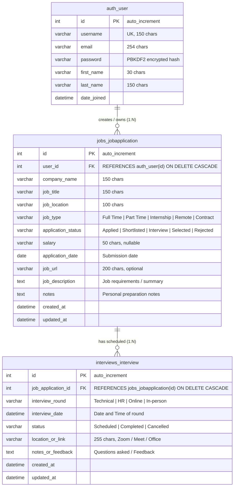

# JobTrack – System Architecture & Technical Blueprint

This document details the architectural layout, entity-relationship diagrams, request-response lifecycles, and API design of the JobTrack web application.

---

## 1. High-Level Application Architecture

JobTrack follows a clean, decoupled **Django Monolithic Architecture** with clear boundaries between user accounts, core application tracking, interview management, and REST APIs.

```mermaid
flowchart TD
    subgraph Client Layer
        Browser["Desktop & Mobile Web Browsers\n(Bootstrap 5.3 + Chart.js)"]
        APIClient["REST API Clients / Mobile Apps\n(cURL / Postman / Axios)"]
    end

    subgraph Security & Middleware
        WSGI["WSGI Web Server Gateway (manage.py runserver / Gunicorn)"]
        SecurityMW["SecurityMiddleware (SSL, HSTS, X-Content-Type)"]
        SessionMW["SessionMiddleware (Cookie-based Sessions)"]
        CSRFMW["CsrfViewMiddleware (Token Verification)"]
        AuthMW["AuthenticationMiddleware (request.user Injection)"]
    end

    subgraph Django Core Application
        RootURL["Root URL Dispatcher (config/urls.py)"]
        
        subgraph Modular Apps
            AccountsApp["accounts\n- UserRegisterForm\n- UserLoginForm\n- profile_view"]
            JobsApp["jobs\n- JobApplication CRUD\n- Search & Filter Engine\n- views_dashboard.py"]
            InterviewsApp["interviews\n- Interview Scheduling\n- Round Tracking\n- Status Progression"]
            APIApp["api (DRF)\n- ModelSerializers\n- ModelViewSets\n- Token / Session Auth"]
        end

        DTLEngine["Django Template Language Engine\n(base.html + inheritance)"]
    end

    subgraph Persistence Layer
        ORM["Django ORM (Object-Relational Mapping)"]
        PyMySQL["PyMySQL Driver (install_as_MySQLdb)"]
        MySQL[("MySQL 8.0 Database (jobtrack_db)\n- auth_user\n- jobs_jobapplication\n- interviews_interview\n- django_session")]
    end

    Browser -->|HTTP GET/POST + CSRF| WSGI
    APIClient -->|JSON REST Requests| WSGI
    WSGI --> SecurityMW
    SecurityMW --> SessionMW
    SessionMW --> CSRFMW
    CSRFMW --> AuthMW
    AuthMW --> RootURL

    RootURL -->|/login, /register, /profile| AccountsApp
    RootURL -->|/, /applications/*, /analytics| JobsApp
    RootURL -->|/interviews/*| InterviewsApp
    RootURL -->|/api/*| APIApp

    AccountsApp --> ORM
    JobsApp --> ORM
    InterviewsApp --> ORM
    APIApp --> ORM

    AccountsApp & JobsApp & InterviewsApp --> DTLEngine
    DTLEngine --> Browser
    APIApp -->|JSON Response (200, 201, 400, 404)| APIClient

    ORM --> PyMySQL
    PyMySQL -->|TCP Port 3306| MySQL
```

---

## 2. Request-Response Lifecycle Flow

When a user interacts with JobTrack, the execution flow proceeds through standard Django pipeline phases:

```mermaid
sequenceDiagram
    autonumber
    actor User as Web Browser
    participant MW as Django Middleware
    participant URL as URLConf (config/urls.py)
    participant View as View Function / ViewSet
    participant ORM as Django ORM
    participant DB as MySQL Database
    participant Tpl as Template Engine

    User->>MW: HTTP POST /applications/new/ (Form Data + CSRF)
    MW->>MW: Verify CSRF token and validate sessionid
    MW->>URL: Route request to 'job_create_view'
    URL->>View: Execute job_create_view(request)
    View->>View: Bind request.POST to JobApplicationForm
    View->>View: form.is_valid() -> Strip inputs & sanitize
    View->>ORM: application.user = request.user; application.save()
    ORM->>DB: INSERT INTO jobs_jobapplication (...) VALUES (...);
    DB-->>ORM: Commit OK, auto-increment id returned
    ORM-->>View: Saved Model Instance
    View->>Tpl: messages.success() & redirect('job_detail', pk)
    Tpl-->>User: HTTP 302 Redirect -> HTTP 200 Rendered Detail Page
```

---

## 3. Database Entity-Relationship (ER) Diagram

The MySQL database schema is normalized to 3rd Normal Form (3NF) to eliminate data redundancy and preserve integrity.



---

## 4. Frontend-to-Backend Data Flow

```mermaid
flowchart LR
    subgraph Browser Client
        HTML[HTML5 / DTL Templates]
        BS[Bootstrap 5.3 CSS & Components]
        JS[JavaScript DOM Helpers]
        ChartJS[Chart.js 4.4 Canvas Visualizations]
    end

    subgraph Django Controller
        Views[View Callbacks & Context Builder]
        JSONData[json.dumps() Serialized Data]
    end

    subgraph Database Layer
        Queries[ORM Aggregation: count(), filter()]
    end

    Queries --> Views
    Views --> JSONData
    JSONData --> ChartJS
    Views --> HTML
    BS --> HTML
    JS --> HTML
```

---

## 5. REST API Architecture (DRF)

JobTrack exposes a clean, predictable RESTful API structured via `rest_framework.routers.DefaultRouter`:

| Endpoint URI | HTTP Method | Action / Purpose | Auth Required |
| :--- | :--- | :--- | :--- |
| `/api/applications/` | `GET` | List all applications for current user | Yes (`IsAuthenticated`) |
| `/api/applications/` | `POST` | Create a new job application | Yes |
| `/api/applications/{id}/` | `GET` | Retrieve application details & nested interviews | Yes |
| `/api/applications/{id}/` | `PUT` | Full update of an application | Yes |
| `/api/applications/{id}/` | `PATCH` | Partial update of an application | Yes |
| `/api/applications/{id}/` | `DELETE` | Delete application and cascade delete interviews | Yes |
| `/api/interviews/` | `GET` | List all interviews for current user | Yes |
| `/api/interviews/` | `POST` | Schedule an interview (advances job status) | Yes |
| `/api/interviews/{id}/` | `GET` | Retrieve interview details | Yes |
| `/api/interviews/{id}/` | `PUT` / `PATCH` | Update interview round, time, or feedback | Yes |
| `/api/interviews/{id}/` | `DELETE` | Delete an interview | Yes |
| `/api/dashboard/` | `GET` | Live counters, status distribution, conversion rates | Yes |
| `/api/user/` | `GET` | Current user profile and username | Yes |
